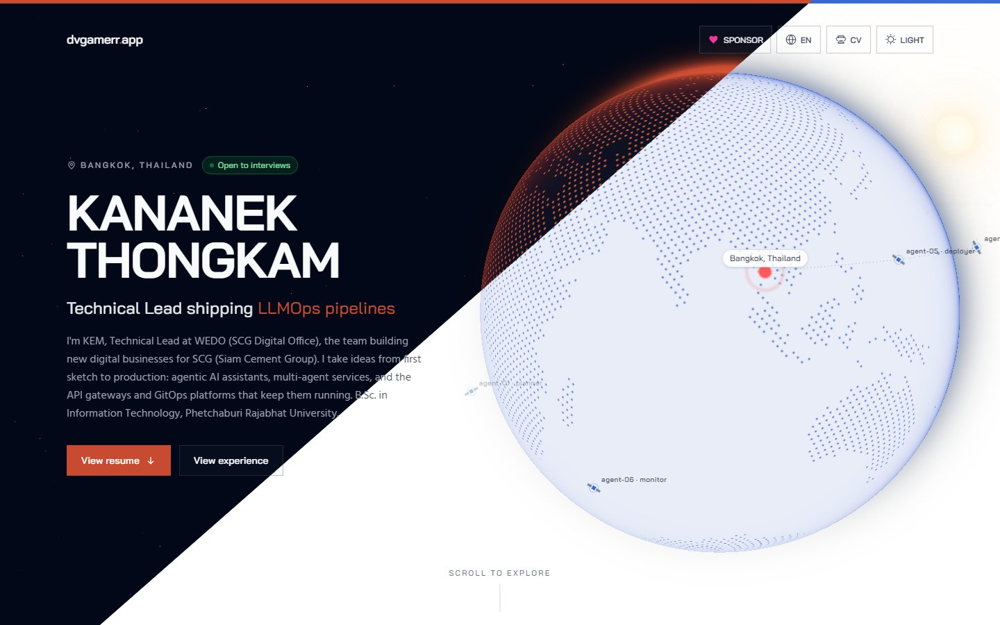

<div align="center">

# dvgamerr.app

**พอร์ตโฟลิโอนักพัฒนาสองภาษา (EN/TH) ที่มี hero ลูกโลก 3D และเอาโค้ดไป fork ใช้ต่อได้เลย**

หน้า static จาก Astro, Svelte 5 เฉพาะ island ที่จำเป็น, ลูกโลก WebGL ที่ขยับตามการ scroll และ resume ที่ขับด้วย JSON กับ Markdown ทั้งหมด

<p>
  <a href="https://github.com/dvgamerr-app/dvgamerr-app.github.io/stargazers"></a>
  <a href="./LICENSE"></a>
  <a href="https://dvgamerr.app"></a>
  <br/>
  
  
  
  
</p>

<p>
  <a href="https://dvgamerr.app/th/">เว็บไซต์จริง</a>
  · <a href="https://dvgamerr.app/">English version</a>
  · <a href="#เริ่มต้นใช้งาน">เริ่มต้นใช้งาน</a>
  · <a href="#ปรับเป็นของคุณ">ปรับเป็นของคุณ</a>
  · <a href="./README.md">English</a>
</p>



**ถ้า repo นี้ช่วยให้คุณไม่ต้องเริ่มทำพอร์ตโฟลิโอจากศูนย์ ฝากกด ⭐ เพื่อให้นักพัฒนาคนอื่นหาเจอด้วยนะคะ**

</div>

---

## ทำไมต้องเว็บนี้

- **Hero ที่จำได้ติดตา** ลูกโลกเต็มจอจาก [Motion Core](https://motion-core.dev/) โฟกัสที่กรุงเทพฯ เป็นฉากหลังทั้งหน้า ท้องฟ้าเปลี่ยนตามธีม (ดวงอาทิตย์ ดวงจันทร์ ดาว god rays) มีดาวเทียมโคจร และเมื่อ scroll ลงไปลูกโลกจะหมุนลงเป็นขอบฟ้าหลัง resume
- **เร็วตั้งแต่ต้นทาง** หน้าเป็น HTML static และมี island ที่ hydrate แค่สามตัว (`Hero` ตอนโหลด, profile badges ตอน idle, ช่องโฆษณาตอนเลื่อนมาเห็น) โดย Hero island ขนาดราว 83 KB gzip รวม GSAP และ OGL แล้ว
- **สองภาษา โค้ดชุดเดียว** English ที่ `/` และไทยที่ `/th/` ใช้ component เดียวกัน แยกแค่ไฟล์ JSON
- **เนื้อหาคือข้อมูล** แก้ JSON กับ Markdown ไม่ต้องแตะ markup ตัวเลขรายได้ สถิติ และกราฟ coding คำนวณจากไฟล์ข้อมูล

## ฟีเจอร์

|     | ฟีเจอร์               | สิ่งที่ได้                                                                                                                           |
| --- | --------------------- | ------------------------------------------------------------------------------------------------------------------------------------ |
| 🌍  | **Hero ลูกโลก 3D**    | ลูกโลก WebGL (OGL) ที่ปรับท่าตาม scroll ด้วย GSAP ScrollTrigger และแสงขอบกับชั้นบรรยากาศที่ตามดวงอาทิตย์หรือดวงจันทร์                |
| 🛰️  | **ชั้นดาวเทียม**      | ดาวเทียมที่เปลี่ยนภารกิจ เชื่อมต่อ agent และ uplink ไปกรุงเทพฯ รวมถึง UFO ที่แวะมาแล้วเกิด timeline glitch → debug → fix → recovered |
| 🌗  | **ธีมสว่างและมืด**    | ปุ่มสลับธีมที่อัปเดต `theme-color` meta tag ด้วย                                                                                     |
| 🇹🇭  | **i18n EN/TH**        | ข้อมูล resume และข้อความ UI แยกภาษา และตัวอักษรไทยจะไม่ใส่ letter-spacing ใน label ตัวพิมพ์ใหญ่                                      |
| 📊  | **Coding telemetry**  | กราฟจาก WakaTime ทั้งภาษา ประเภทงาน การเขียนโค้ดด้วย AI และ repository                                                               |
| 🧩  | **Section ใช้ซ้ำได้** | `SectionShell` และ `StatGrid` ทำให้ layout ทุก section ตรงกัน                                                                        |
| 📱  | **PWA**               | ติดตั้งได้ผ่าน `@vite-pwa/astro` พร้อม sitemap, robots.txt และ Open Graph                                                            |
| 🖨️  | **พิมพ์ resume ได้**  | print style ซ่อน hero กับลูกโลก และแสดงฟิลด์ resume เฉพาะตอนพิมพ์                                                                    |
| ♿  | **Reduced motion**    | เมื่อเปิด `prefers-reduced-motion` ลูกโลกจะค้างท่า hero และมีแค่ fade                                                                |
| 🤖  | **`llms.txt`**        | สรุปสำหรับเครื่องอ่านที่ `/llms.txt`                                                                                                 |

## เริ่มต้นใช้งาน

ต้องมี [Bun](https://bun.sh/) 1.3.14 ขึ้นไป

```shell
git clone https://github.com/dvgamerr-app/dvgamerr-app.github.io.git
cd dvgamerr-app.github.io
bun install
bun run dev
```

เปิด URL ที่ Astro แสดง (ปกติ `http://localhost:4321`) จะได้หน้า English และเพิ่ม `/th/` สำหรับหน้าไทย

สร้างเว็บ static ลง `dist/`:

```shell
bun run build
```

## ปรับเป็นของคุณ

| สิ่งที่แก้                           | อยู่ที่ไหน                                                                                   |
| ------------------------------------ | -------------------------------------------------------------------------------------------- |
| ข้อความ resume และคำใน hero (`hero`) | `src/i18n/resume.en.json`, `src/i18n/resume.th.json`                                         |
| ประวัติการทำงาน                      | `src/components/work/en/*.md`, `src/components/work/th/*.md`                                 |
| ตัวเลขรายได้ที่คำนวณจากเงินเดือน     | `src/i18n/experience.json`                                                                   |
| Coding และ AI telemetry              | `src/i18n/coding.json`, `src/i18n/telemetry.json`                                            |
| หน้าหลัก                             | `src/pages/index.astro` (EN), `src/pages/th/index.astro` (TH)                                |
| Layout ของ section ที่ใช้ร่วมกัน     | `src/components/SectionShell.svelte`, `src/components/StatGrid.svelte`                       |
| สไตล์ปุ่มและ pill                    | `src/lib/ui.ts`                                                                              |
| ลูกโลก ท้องฟ้า และดาวเทียม           | `src/components/Hero.svelte`, `SkyLayer.svelte`, `SatelliteLayer.svelte`, `src/lib/orbit.ts` |

แทนที่ข้อมูลส่วนตัว ไอคอนใน `public/` และโดเมนใน `CNAME` กับ `astro.config.mjs`

## สถาปัตยกรรม

```
  Markdown + JSON (src/i18n, src/components/work)
            │
            ▼
  Astro pages  ──►  static HTML  (/  และ  /th/)
            │
            ▼
  Svelte 5 islands: Hero (load) · ProfileBadges (idle)            │
            ▼
  Motion Core globe (OGL) + GSAP ScrollTrigger + ชั้นท้องฟ้าและดาวเทียม
```

Stack: Astro 7, Svelte 5, TypeScript 5/6, Tailwind CSS 4, GSAP, OGL, Bun

> ยังไม่รองรับ TypeScript 7 เพราะ `@astrojs/svelte` และ typescript-eslint ยังไม่รองรับ

## สำหรับนักพัฒนา

```shell
bun run lint      # ESLint
bun run format    # ตรวจ Prettier (ใช้ format:fix เพื่อแก้ให้)
bun run build     # build static ลง dist/
```

Motion Core components ถูก vendor ไว้ใน `src/lib/motion-core/` เพิ่มได้ด้วย `bunx @motion-core/cli add <slug>` และห้ามรัน token sync ของ `motion-core init` ลง `global.css` ดู patch ที่ต้องใส่ซ้ำหลังอัปเดตลูกโลกหรือ god-rays ได้ใน [CLAUDE.md](./CLAUDE.md)

## สนับสนุนโปรเจกต์

- ⭐ [กด Star ที่ repo](https://github.com/dvgamerr-app/dvgamerr-app.github.io) ถ้าเป็นประโยชน์
- 🐛 [เปิด Issue](https://github.com/dvgamerr-app/dvgamerr-app.github.io/issues) เมื่อเจอบั๊กหรือมีไอเดีย
- 🔀 ยินดีรับ Pull Request

## ลิขสิทธิ์และเครดิต

MIT ดูที่ [LICENSE](./LICENSE) ถ้า fork ไปใช้ ให้แทนที่เนื้อหาส่วนตัว (ข้อความ resume รูปภาพ ประวัติการทำงาน) ด้วยของคุณเอง

Reference tools: [Mini QR Code Generator](https://mini-qr-code-generator.vercel.app/), [IconScout](https://iconscout.com/)
